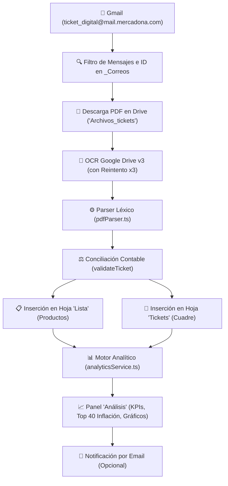

# 🛒 Mercadona Tickets Analytics & Automation

[](https://www.typescriptlang.org/)
[](https://developers.google.com/apps-script)
[](test/)
[](LICENSE)

Sistema integral y autónomo en la nube para la **ingesta desatendida, extracción mediante OCR, conciliación contable matemática y analítica inteligente** de tickets digitales de compra de Mercadona en **Google Sheets** y **Google Drive**.

El sistema funciona de forma **100% gratuita, privada y desatendida** ejecutándose en la infraestructura de Google Workspace, sin servidores externos, suscripciones ni dependencias de terceros.

---

## 📑 Tabla de Contenidos

- [🎯 Capacidades Funcionales](#-capacidades-funcionales)
  - [1. Ingesta Automática y Sin Duplicados](#1-ingesta-automática-y-sin-duplicados)
  - [2. Motor de Extracción OCR Inteligente (Google Drive v3)](#2-motor-de-extracción-ocr-inteligente-google-drive-v3)
  - [3. Conciliación Contable y Autocorrección](#3-conciliación-contable-y-autocorrección)
  - [4. Estructura de Pestañas en Google Sheets](#4-estructura-de-pestañas-en-google-sheets)
  - [5. Cuadro de Mando y Analítica (`Análisis`)](#5-cuadro-de-mando-y-analítica-análisis)
  - [6. Centro de Mando y Menú Integrado](#6-centro-de-mando-y-menú-integrado)
  - [7. Avisos y Notificaciones por Correo](#7-avisos-y-notificaciones-por-correo)
- [🏗️ Arquitectura Técnica y de Software](#️-arquitectura-técnica-y-de-software)
  - [Estructura del Proyecto](#estructura-del-proyecto)
  - [Flujo de Procesamiento de Datos](#flujo-de-procesamiento-de-datos)
  - [Tipado Estricto TypeScript](#tipado-estricto-typescript)
  - [Empaquetado para Google Apps Script](#empaquetado-para-google-apps-script)
- [🧪 Pruebas Unitarias y Calidad](#-pruebas-unitarias-y-calidad)
- [🚀 Guía de Instalación y Despliegue](#-guía-de-instalación-y-despliegue)
- [🛡️ Seguridad y Privacidad](#️-seguridad-y-privacidad)
- [📄 Licencia](#-licencia)

---

## 🎯 Capacidades Funcionales

### 1. Ingesta Automática y Sin Duplicados
- **Escaneo Inteligente de Gmail:** Rastrea automáticamente los mensajes provenientes de `ticket_digital@mail.mercadona.com`.
- **Seguimiento por `Message-ID` de Gmail:** Almacena los identificadores procesados en la hoja técnica oculta `_Correos`. Esto garantiza que, si Gmail agrupa varios tickets en un mismo hilo de conversación, ningún ticket se quede sin procesar.
- **Almacenamiento Estructurado en Drive:** Crea y mantiene la carpeta `Archivos_tickets` en la raíz de tu Google Drive, guardando los PDFs descargados con un nombre limpio y normalizado.
- **Control de Ficheros Duplicados:** Detecta y previene la creación de archivos redundantes con sufijos tipo `(1)` en Google Drive.
- **Prevención de Concurrencia:** Utiliza el bloqueo atómico `LockService` de Google Apps Script para impedir que ejecuciones manuales y programadas se solapen.

### 2. Motor de Extracción OCR Inteligente (Google Drive v3)
- **OCR Gratuito en la Nube:** Transforma el PDF en documento temporal de texto mediante la API de Google Drive v3, extrayendo el contenido textual del ticket sin recurrir a servicios de pago de terceros.
- **Tolerancia a Fallos y Reintento Automático (x3):** Incorpora un mecanismo de reintento con retroceso exponencial (*exponential backoff*) que absorbe microcortes y errores intermitentes (`500 Internal Error`) de los servidores de Google.
- **Normalización de Texto Continuo y Multilínea:** El parser es capaz de procesar tanto texto formateado línea a línea como flujos continuos de caracteres sin saltos de línea (formato típico generado por el motor Docs OCR).
- **Soporte Multipágina:** Detecta y limpia cabeceras repetidas en tickets que ocupan más de una página física.
- **Diferenciación de Peso (`kg`) vs Unidades (`ud`):**
  - Identifica si un artículo se vende por unidades fijas o al peso.
  - Para productos pesados (frutas, verduras, carne, pescado), extrae el **precio real por kilogramo** y el peso exacto, lo que permite realizar un seguimiento real de la inflación sin distorsiones por el tamaño de la bandeja.
- **Manejo de Casos Particulares:** Soporte para descuentos por cupones, promociones especiales, devoluciones de envases y caracteres ortográficos españoles (tildes, `ñ`, diéresis).
- **Delimitación de Tienda:** Aísla de forma precisa la dirección y código postal del supermercado en la cabecera, evitando falsos positivos con nombres de productos o marcas.

### 3. Conciliación Contable y Autocorrección
- **Validación Matemática Céntimo a Céntimo:** Suma el importe de cada línea de artículo y lo coteja contra el total impreso en la factura.
- **Semáforo de Estado en la pestaña `Tickets`:**
  - `✅ OK`: Cuadre matemático exacto entre líneas y total.
  - `⚠️ REVISAR`: Descuadre numérico, total no encontrado o ticket con fecha dudosa.
  - `❌ ERROR`: Fallo durante la descarga del PDF o lectura OCR inaccesible.
- **Hipervínculos Nativos Directos (`RichTextValue`):** Utiliza enlaces enriquecidos directos al archivo en Drive en lugar de fórmulas `=HYPERLINK()`. Esto evita que las celdas muestren `#ERROR!` en hojas configuradas con separador de coma o punto y coma según el idioma regional.
- **Reparación en Un Clic (`🔧 Reparar enlaces #ERROR! existentes`):** Función de mantenimiento que recorre las columnas de enlaces y las convierte al vuelo a formato nativo limpio.
- **Reintento Selectivo (`🔁 Reintentar solo los tickets en ERROR`):** Permite reprocesar exclusivamente las filas marcadas en rojo sin necesidad de volver a descargar ni duplicar las compras ya validadas.

---

### 4. Estructura de Pestañas en Google Sheets

| Pestaña | Propósito | Columnas / Contenido Clave |
| :--- | :--- | :--- |
| **`Lista`** | Detalle a nivel de artículo individual | `Fecha`, `Tienda`, `Factura`, `Producto`, `Unidades / Peso`, `Tipo Unidad` (`ud`/`kg`), `Precio Unitario`, `Total Línea`, `Ticket PDF` |
| **`Tickets`** | Resumen y conciliación por acto de compra | `Fecha`, `Hora`, `Factura`, `Tienda`, `Total Impreso`, `Total Calculado`, `Diferencia`, `Estado` (`✅ OK`, `⚠️ REVISAR`, `❌ ERROR`), `Enlace PDF` |
| **`Análisis`** | Cuadro de mando ejecutivo y métricas | KPIs principales, Gráficos temporales, Top 10 más comprados, Top 10 recurrentes abandonados, Top 40 inflación |
| **`📡 Estado`** | Monitorización técnica en vivo | Semáforo en tiempo real (`🟢 EN REPOSO`, `🔄 EJECUTANDO AHORA`), contadores de filas y registro de los últimos 15 eventos |
| **`Instrucciones`** | Manual de usuario integrado | Guía de uso, botones del menú y resolución de dudas dentro del propio libro |
| **`_Correos`** | Control interno de sincronización (Oculta) | `Message-ID` de Gmail y fecha de procesamiento para garantizar deduplicación estricta |

---

### 5. Cuadro de Mando y Analítica (`Análisis`)

El sistema reconstruye y refresca automáticamente la pestaña `Análisis` con los siguientes módulos visuales:

1. **5 Tarjetas de KPIs Principales:**
   - **Gasto Total Acumulado (€)**
   - **Número Total de Compras**
   - **Ticket Medio por Compra (€)**
   - **Gasto Medio Mensual (€)**
   - **Índice de Conciliación (% de tickets verificados `✅ OK`)**

2. **2 Gráficos Cronológicos Nativos:**
   - **Evolución del Importe por Compra:** Gráfico de columnas o líneas con la cronología de cada visita a tienda.
   - **Gasto Mensual Agregado:** Comparativa de gasto total mes a mes (`mm/aaaa`).

3. **Top 10 Productos Más Comprados:**
   - Ranking por número de veces adquirido y gasto total acumulado.
   - **Filtro de Ruido:** Excluye automáticamente bolsas de plástico/papel y complementos para mostrar únicamente alimentos y productos reales de cesta de la compra.

4. **Top 10 Recurrentes Abandonados:**
   - Algoritmo que calcula el **intervalo medio de recompra propio de cada producto**.
   - Alerta cuando un producto habitual supera ampliamente su ciclo habitual sin ser comprado, ayudando a recordar compras olvidadas.

5. **Top 40 Monitor de Inflación y Variación de Precios:**
   - Para los 40 productos con mayor presencia:
     - Tipo de unidad (`€/ud` o `€/kg`).
     - Número de compras registradas.
     - **Último precio pagado y su fecha.**
     - **Máximo histórico registrado y su fecha.**
     - **Mínimo histórico registrado y su fecha.**
     - **% de Variación de Precio** con formato condicional en semáforo (verde = bajada o estable, amarillo = subida moderada, rojo = subida fuerte).

6. **Histórico Integrado:**
   - Registro cronológico de tickets situado al final de la hoja para no interferir visualmente con el panel superior.

---

### 6. Centro de Mando y Menú Integrado

Al abrir la hoja de cálculo se añade automáticamente en la barra superior el menú **`🛒 Mercadona`**:

- **`⚡ Importar TODO el histórico automáticamente`**: Ejecuta la carga inicial o sincronización de todos los correos históricos en tandas seguras de 4 minutos con autoreactivación de disparadores.
- **`🔁 Reintentar solo los tickets en ERROR`**: Busca tickets pendientes o fallidos y los reintenta de forma quirúrgica.
- **`🔧 Reparar enlaces #ERROR! existentes`**: Convierte fórmulas antiguas de enlaces a hipervínculos nativos directos.
- **`⏰ Activar comprobación automática diaria (09:00)`**: Configura el disparador temporal de Google para ejecutarse cada mañana entre las 09:00 y las 10:00.
- **`🛑 Desactivar comprobación automática diaria`**: Elimina los disparadores programados.
- **`📧 Avisos por email`**: Activa o desactiva las alertas por correo electrónico.
- **`📡 Ver estado de ejecución en tiempo real`**: Navega a la pestaña `📡 Estado` y refresca los indicadores.
- **`🔄 Reiniciar importación desde cero (con copia de seguridad)`**: Opción de reinicio seguro que respalda los datos previos antes de vaciar las tablas para una nueva ingesta limpia.

---

### 7. Avisos y Notificaciones por Correo
- **Alerta de Compra Diaria:** Si la tarea programada matinal detecta compras nuevas, envía un correo HTML limpio con el desglose del ticket y el estado del cuadre.
- **Notificación de Incidencias:** Envía un aviso si algún ticket no ha podido leerse tras agotar los 3 reintentos de Drive OCR.
- **Silencio en Días sin Compra:** No envía mensajes innecesarios si no ha habido actividad en Mercadona ese día.
- **Resumen de Importación Masiva:** Emite un único correo resumen al concluir la carga histórica global.

---

## 🏗️ Arquitectura Técnica y de Software

El proyecto está diseñado bajo principios de arquitectura limpia y desacoplamiento estricto, escrito en **TypeScript** y compilado a un único artefacto compatible con el runtime V8 de **Google Apps Script**.

### Estructura del Proyecto

```text
Mercadona-Tickets-Analytics/
├── .gitignore                      # Exclusiones de Git (node_modules, logs, etc.)
├── package.json                    # Scripts npm y dependencias de compilación
├── tsconfig.json                   # Configuración de TypeScript estricto
├── dist/
│   └── Codigo_AppsScript.gs        # Paquete distribuible final para Google Sheets
├── docs/
│   └── manual/
│       └── MANUAL_INSTALACION_Y_USO.md # Manual detallado paso a paso para el usuario
├── scripts/
│   └── build-gas.mjs               # Empaquetador modular TypeScript -> Google Apps Script
├── src/
│   ├── types/
│   │   └── index.ts                # Contratos de tipos, interfaces de datos y estados
│   ├── utils/
│   │   ├── pdfParser.ts            # Parser OCR, analizador léxico y validador contable
│   │   └── sheetUtils.ts           # Formateo de fechas, hipervínculos nativos y moneda
│   ├── services/
│   │   ├── googleService.ts        # Integración GmailApp, DriveApp, Drive API y Sheets
│   │   ├── analyticsService.ts     # Motor analítico, inflación, series y rankings
│   │   ├── statusService.ts        # Máquina de estados, logs y alertas toast
│   │   └── notificationService.ts  # Generador de plantillas de correo HTML
│   ├── ui/
│   │   ├── dashboardView.ts        # Renderizado de KPIs, gráficos y tablas de Análisis
│   │   ├── statusView.ts           # Vista del semáforo y consola de actividad
│   │   └── instructionsView.ts     # Generación de la pestaña Instrucciones en la hoja
│   └── main.ts                     # Punto de entrada, menús, triggers y LockService
└── test/
    ├── analytics.test.ts           # Pruebas del motor analítico y cálculo de inflación
    ├── deduplication.test.ts       # Pruebas de prevención de facturas y correos duplicados
    ├── pdfParser.test.ts           # Pruebas del parser OCR con tickets reales anonimizados
    └── sheetUtils.test.ts          # Pruebas de utilidades de hojas y enlaces
```

### Flujo de Procesamiento de Datos



### Tipado Estricto TypeScript
El código prescinde de tipos `any`, garantizando contratos claros para las entidades fundamentales:
- `RawTicketData`: Metadatos leídos del correo y del archivo PDF.
- `ParsedTicket`: Encabezado, lista de artículos normalizados y pie del ticket.
- `TicketItem`: Descripción, cantidad, peso, precio unitario, importe total e indicador de peso.
- `ValidationResult`: Diferencia numérica, estatus (`OK`, `REVISAR`, `ERROR`) y mensaje explicativo.
- `AnalyticsDashboard`: Métricas agregadas, series temporales y tablas de inflación.

### Empaquetado para Google Apps Script
El script `scripts/build-gas.mjs`:
1. Lee todos los módulos de `src/` en el orden de dependencias correcto.
2. Elimina declaraciones `import` / `export` de TypeScript/ESModules.
3. Envuelve el código para el motor V8 de Google Apps Script.
4. Ejecuta una validación sintáctica estricta mediante el módulo `vm.Script` de Node.js antes de generar `dist/Codigo_AppsScript.gs`.

---

## 🧪 Pruebas Unitarias y Calidad

El proyecto incluye una completa batería de pruebas unitarias implementadas con el ejecutor nativo `node --test` de Node.js, validando el comportamiento con tickets reales anonimizados:

```bash
# 1. Comprobación estática de tipos (0 errores)
npm.cmd run lint

# 2. Ejecución de la suite completa de tests (12/12 tests pasando)
npm.cmd test

# 3. Compilación y verificación del archivo final Google Apps Script
npm.cmd run build
```

---

## 🚀 Guía de Instalación y Despliegue

La instalación solo debe realizarse una vez y toma menos de 3 minutos:

1. **Crear o abrir tu hoja de cálculo:** Crea una nueva hoja de cálculo en Google Drive o abre tu hoja existente (por ejemplo, llamada `Listado_tickets`).
2. **Abrir el editor de Apps Script:** En el menú superior de Google Sheets, ve a **`Extensiones` > `Apps Script`**.
3. **Activar el servicio Drive API:**
   - En la barra lateral izquierda del editor, haz clic en el icono **`+`** junto a **Servicios**.
   - Selecciona **Drive API** (versión recomendada v2/v3) y pulsa **Añadir**.
4. **Pegar el código empaquetado:**
   - Abre en tu equipo el archivo generado [`dist/Codigo_AppsScript.gs`](dist/Codigo_AppsScript.gs).
   - Copia todo su contenido (`Ctrl + A`, `Ctrl + C`).
   - En el editor de Apps Script, reemplaza el código de `Código.gs` con el contenido copiado y guarda (`Ctrl + S`).
5. **Iniciar el menú y usar:**
   - Cierra el editor de Apps Script y recarga la hoja de cálculo (`F5`).
   - Aparecerá el menú **`🛒 Mercadona`** en la barra superior.
   - Pulsa **`⚡ Importar TODO el histórico automáticamente`** para la carga inicial o activa la revisión matinal con **`⏰ Activar comprobación automática diaria (09:00)`**.

> [!TIP]
> Para una guía gráfica y detallada de uso cotidiano, consulta el [Manual de Instalación y Uso](docs/manual/MANUAL_INSTALACION_Y_USO.md) o la pestaña **`Instrucciones`** que se creará automáticamente dentro de tu hoja.

---

## 🛡️ Seguridad y Privacidad

- **Tus datos nunca salen de tu cuenta de Google:** El script se ejecuta íntegramente dentro de tu propio entorno de Google Apps Script y Google Drive.
- **Sin servidores externos:** No hay conexiones a APIs de terceros, servidores analíticos ni bases de datos externas.
- **Código Abierto y Auditable:** Todo el código fuente en TypeScript y el código empaquetado `.gs` es 100% visible, modular e inspeccionable.

---

## 📄 Licencia

Este proyecto está bajo la Licencia **MIT**. Consulta el archivo `LICENSE` o el pie de este repositorio para más detalles.
